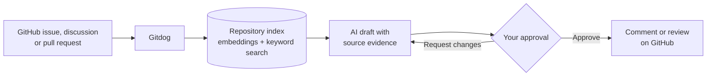

<p align="center">
  <a href="https://gitdog.dev">
    <picture>
      <source media="(prefers-color-scheme: dark)" srcset=".github/assets/gitdog-logo.png">
      <source media="(prefers-color-scheme: light)" srcset=".github/assets/gitdog-logo-dark.png">
      
    </picture>
  </a>
</p>

<h1 align="center">Gitdog</h1>

<p align="center">
  <strong>The codebase-aware assistant for GitHub issues, discussions and pull requests.</strong>
  <br>
  Grounded in your repository. Published only when you approve.
</p>

<p align="center">
  <a href="https://gitdog.dev"></a>
  <a href="https://github.com/hyodotdev/gitdog/actions/workflows/ci.yml"></a>
  <a href="https://github.com/hyodotdev/gitdog/actions/workflows/cli-ci.yml"></a>
  <a href="https://www.npmjs.com/package/gitdog"></a>
</p>

<p align="center">
  <a href="https://gitdog.dev">Website</a>
  ·
  <a href="packages/cli">CLI</a>
  ·
  <a href="docs/ai-models.md">AI models</a>
  ·
  <a href="CONTRIBUTING.md">Contributing</a>
  ·
  <a href="https://github.com/hyodotdev/gitdog/issues">Issues</a>
</p>

---

## Why Gitdog

Maintainers answer the same questions, triage vague reports and review routine
changes every day. Gitdog indexes your repository and drafts the work for you —
with the actual code as evidence, not generic advice.

|                          | What it does                                                                     |
| ------------------------ | -------------------------------------------------------------------------------- |
| **Issue assistant**      | Turns rough reports into clear, structured issues and answers questions          |
| **Discussion assistant** | Replies to GitHub Discussions with context from your codebase                    |
| **Pull request reviews** | Reviews changed code against the repository and suggests concrete fixes          |
| **Maintainer tagging**   | Notifies the right people when a request needs a code change                     |
| **Approval first**       | With approval on (the default), drafts wait in your queue until you approve them |
| **Team workspace**       | Share projects with members and keep per-project settings and usage in one place |

## How it works



1. **Connect** a repository through the Gitdog GitHub App.
2. **Index** — Gitdog builds a searchable index of your code and keeps it in
   sync with the default branch.
3. **Draft** — new issues, discussions and pull requests get a reply or review
   grounded in the indexed source.
4. **Approve** — review the draft in Gitdog or the CLI, then publish it.

## Get started

**On the web** — sign in with GitHub at [gitdog.dev](https://gitdog.dev),
install the GitHub App and connect a repository. Try Gitdog with 100K one-time
trial tokens, then use your own Anthropic or OpenAI API key or Pro; no credit
card required.

**From the terminal** — the [`gitdog` CLI](packages/cli) manages projects,
settings and approvals:

```sh
npx gitdog@latest login
npx gitdog@latest init owner/repo
npx gitdog@latest tickets pending
```

## Repository layout

This is a monorepo managed with bun workspaces.

| Path                            | Description                                                                |
| ------------------------------- | -------------------------------------------------------------------------- |
| [`src/`](src)                   | Web app — React 19, TypeScript, Tailwind CSS                               |
| [`convex/`](convex)             | Backend — Convex functions, GitHub App, AI workflows and billing           |
| [`packages/cli/`](packages/cli) | The `gitdog` CLI, published to [npm](https://www.npmjs.com/package/gitdog) |
| [`docs/`](docs)                 | Conventions, GitHub App setup and AI model notes                           |

## Development

Requires Node.js 26 (`nvm use`) and Bun 1.4.4.

```sh
bun install
cp .env.example .env.local
bun run dev
```

| Command             | Purpose                                         |
| ------------------- | ----------------------------------------------- |
| `bun run dev`       | Run the web app and Convex dev backend together |
| `bun run typecheck` | Type-check the web app, backend and e2e runners |
| `bun run lint`      | ESLint across the monorepo                      |
| `bun run test`      | Web and backend test suites                     |
| `bun run test:cli`  | CLI test suite                                  |
| `bun run check:api` | Verify the CLI API catalog matches the backend  |

See [CONTRIBUTING.md](CONTRIBUTING.md) before opening a pull request.

## Tech stack

| Layer    | Technology                                                           |
| -------- | -------------------------------------------------------------------- |
| Frontend | React 19, TypeScript, Vite, Tailwind CSS, react-i18next (en, ko, ja) |
| Backend  | Convex                                                               |
| AI       | Claude Sonnet 5.5 with GPT-6.1 Sol fallback; OpenAI embeddings       |
| GitHub   | GitHub App (OAuth, webhooks, repository access)                      |
| Payments | Lemon Squeezy                                                        |
| Hosting  | Firebase Hosting                                                     |

## Documentation

- [AI models and pricing](docs/ai-models.md)
- [GitHub App setup](docs/github-app-setup.md)
- [Code conventions](docs/convention.md)
- [CLI reference](packages/cli/docs/REFERENCE.md)

## Security

Please report security issues privately to [hyo@hyo.dev](mailto:hyo@hyo.dev)
instead of opening a public issue.

## License

This repository is currently marked `UNLICENSED` in `package.json`.
