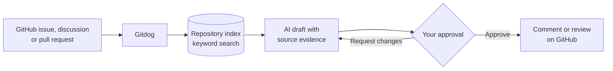

<p align="center">
  <a href="https://gitdog.dev">
    <picture>
      <source media="(prefers-color-scheme: dark)" srcset=".github/assets/gitdog-logo.png">
      <source media="(prefers-color-scheme: light)" srcset=".github/assets/gitdog-logo-dark.png">
      
    </picture>
  </a>
</p>

<h1 align="center">Gitdog</h1>

<p align="center">
  <strong>The codebase-aware assistant for GitHub issues, discussions and pull requests.</strong>
  <br>
  Grounded in your repository. Drafts are published only when you approve.
</p>

<p align="center">
  <a href="https://gitdog.dev"></a>
  <a href="https://github.com/hyodotdev/gitdog/actions/workflows/ci.yml"></a>
  <a href="https://github.com/hyodotdev/gitdog/actions/workflows/cli-ci.yml"></a>
  <a href="https://www.npmjs.com/package/gitdog"></a>
</p>

<p align="center">
  <a href="https://gitdog.dev">Website</a>
  ·
  <a href="packages/cli">CLI</a>
  ·
  <a href="docs/ai-models.md">AI models</a>
  ·
  <a href="CONTRIBUTING.md">Contributing</a>
  ·
  <a href="https://github.com/hyodotdev/gitdog/issues">Issues</a>
</p>

---

## Why Gitdog

Maintainers answer the same questions, triage vague reports and review routine
changes every day. Gitdog indexes your repository and drafts the work for you,
with the actual code as evidence instead of generic advice.

|                          | What it does                                                                            |
| ------------------------ | --------------------------------------------------------------------------------------- |
| **Issue assistant**      | Turns rough reports into clear, structured issues and answers questions                 |
| **Discussion assistant** | Replies to GitHub Discussions with context from your codebase                           |
| **Pull request reviews** | Reviews changed code against the repository, suggests fixes and approves clean code     |
| **Review commands**      | `@gitdogai review`, `full review`, `resolve` and `help` in a pull request, or the CLI   |
| **Maintainer tagging**   | Notifies the right people when a request needs a code change                            |
| **Approval first**       | With approval on (the default), drafts wait in your queue until you approve them        |
| **Your own AI keys**     | Run generation on your Anthropic or OpenAI key, encrypted at rest and never shown again |
| **Team workspace**       | Share projects with members and keep per-project settings and usage in one place        |

## Get started

**On the web**: sign in with GitHub at [gitdog.dev](https://gitdog.dev), install
the GitHub App and connect a repository.

**From the terminal**: the [`gitdog` CLI](packages/cli) manages projects,
settings, approvals and pull request reviews.

```sh
npx gitdog@latest login
npx gitdog@latest init owner/repo
npx gitdog@latest tickets pending
```

## How it works



1. **Connect** a repository through the Gitdog GitHub App.
2. **Index**: Gitdog builds a searchable index of your code and keeps it in sync
   with the default branch.
3. **Draft**: new issues, discussions and pull requests get a reply or review
   grounded in the indexed source.
4. **Approve**: review the draft in Gitdog or the CLI, then publish it.

Gitdog reads the source of every changed file. Files that do not fit the main
review are reviewed in further passes, and a review that still could not read
a file says so.

A pull request review with no findings needs no approval. It posts at once and,
when every changed file was reviewed and no Gitdog thread is open, approves the
reviewed commit. A later push, including updating the branch, withdraws that
approval until the new commits are reviewed.

## Pull request commands

Gitdog reviews a pull request once, when it is opened or marked ready for
review. When you turn pull request reviews on, it also reviews up to five open
pull requests updated in the last 30 days, one about every ten minutes. After
that, ask for more in a pull request comment or from the CLI:

| Pull request comment    | CLI                                         | What it does                                     |
| ----------------------- | ------------------------------------------- | ------------------------------------------------ |
| `@gitdogai review`      | `gitdog reviews request <ticket-id>`        | Reviews the commits pushed since the last review |
| `@gitdogai full review` | `gitdog reviews request <ticket-id> --full` | Reviews the whole pull request again             |
| `@gitdogai resolve`     | `gitdog reviews resolve <ticket-id>`        | Resolves every Gitdog review thread              |
| `@gitdogai help`        | `gitdog reviews --help`                     | Lists the commands                               |

- **Where**: a comment line in the pull request conversation that starts with
  the mention, or follows another review bot's command on the same line
  (`@coderabbitai review @gitdogai review`). Replies inside a review thread
  are not read.
- **Who**: collaborators can run every command. The pull request author, who
  may work from a fork, can run all but `full review`.
- **Other names**: `@gitdogbot`, the app's former name, still works. `@gitdog`
  works as shorthand, but it also notifies the GitHub user of that name, so
  `@gitdogai` is preferred.
- **Status**: while a review runs, one status comment on the pull request shows
  whether it is reviewing, waiting for approval, reviewed, or why it could not
  finish. A review that failed or ran out of tokens can be requested again. For
  automatic reviews, Gitdog posts at most one failure comment a day per pull
  request.
- **Limits**: someone who sends more than 10 commands an hour or 40 a day to
  one repository is paused there for 24 hours. Pull requests opened by bots
  such as Dependabot are not reviewed.

In an issue or discussion, mention `@gitdogai` with a question to get a reply
grounded in the repository.

## Plans

Start with 100K one-time trial tokens, no credit card required. After that, use
Pro (2.4M tokens a month), prepaid token packs, or your own Anthropic or OpenAI
API key. Gitdog runs on Claude Opus 5.5, and each Opus token counts as 2 Gitdog
tokens. Work on your own key never uses Gitdog tokens. See
[AI models and pricing](docs/ai-models.md).

## Your Anthropic and OpenAI keys

If you bring your own provider key, this is exactly how Gitdog handles it:

- **Entry**: only through a hidden prompt or `--stdin` in the CLI, or a
  password field on the web. The CLI refuses a key passed as an argument, so it
  never lands in shell history or process listings.
- **Local copies**: none. The CLI and the browser never write the key to disk
  or browser storage, and the CLI never reads your local Claude Code or Codex
  credentials (`~/.claude`, `~/.codex`, `ANTHROPIC_API_KEY`, `OPENAI_API_KEY`).
- **Transport**: HTTPS, with redirects refused, to the Gitdog backend you use
  (plain HTTP only to a localhost backend you chose yourself). The CLI names
  any non-default backend before it reads the key.
- **Validation**: one request to the provider's own model endpoint; the
  response body is discarded.
- **Storage**: encrypted with AES-256-GCM, a fresh IV per save, and bound to
  your account and provider so a stored key cannot be moved to another
  account. Gitdog's server operators hold the encryption key, so this protects
  against database leaks, not against the operator.
- **Visibility**: after saving, only the provider, the last four characters,
  the key's status and when it was checked are ever shown, to you alone.
  Project API keys and team members cannot reach it, and Gitdog never logs the
  key or the provider's response to the key check.
- **Use**: only for projects you connected to Gitdog. A request that starts on
  your key never falls back to Gitdog's key, and removing the key stops new
  requests on it.
- **Spending**: usage on your key is billed by the provider, and Gitdog does
  not cap it. Anyone who can open issues or pull requests on a connected public
  repository can trigger generation, so set a spend limit with the provider.

## Documentation

- [CLI reference](packages/cli/docs/REFERENCE.md)
- [AI models and pricing](docs/ai-models.md)
- [GitHub App setup](docs/github-app-setup.md)

## Contributing

Development setup, repository layout and checks are in
[CONTRIBUTING.md](CONTRIBUTING.md).

## Security

Please report security issues privately to [hyo@hyo.dev](mailto:hyo@hyo.dev)
instead of opening a public issue.

## License

This repository is currently marked `UNLICENSED` in `package.json`.
